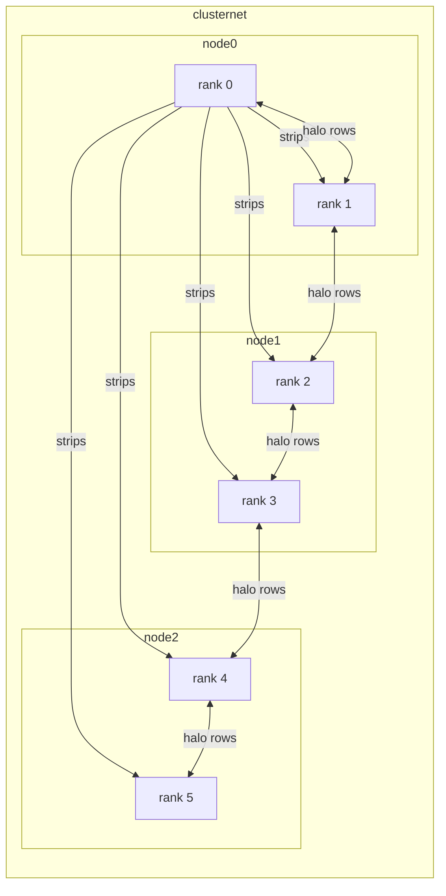
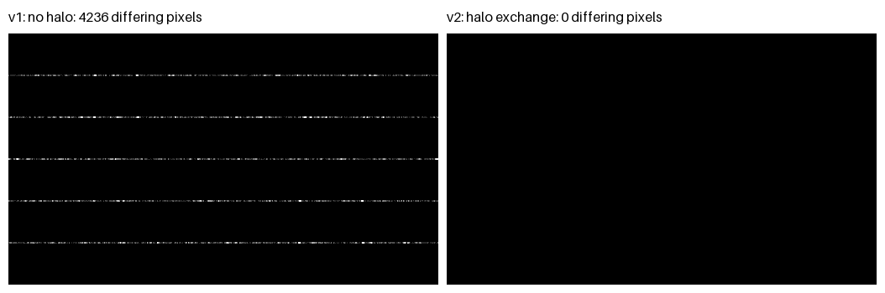

# Parallel Image Filtering with MPI: halo exchange and a debugged hang

> A 3x3 blur split across 6 MPI ranks needs halo rows (4236 pixels differed without them, 0 with them), and a naive "everyone Sends first" exchange hangs once a row is bigger than Open MPI's eager limit (4096 bytes for `vader` on this build), while every container stays healthy.

**Author:** <Rodina878> · **Course:** SCx61 Distributed Computing · **Week 2 — MPI point-to-point**

> Course learning project, not a production system.

## 1. The problem

A 512x300 grayscale image is split into six row strips of 50 rows, one per MPI rank. A 3x3 box blur needs the row above and the row below each pixel. In v1 each rank blurs its strip alone, so at an internal strip border it edge-replicates its own last row instead of using the real neighbour row that lives in another rank. The wrong rows are the two rows on each side of a border: 49-50, 99-100, 149-150, 199-200 and 249-250.

The serial result (`filter_ref.py`) is the right reference because it sees the whole image at once, so it defines what "correct" means; any parallel version must reproduce it exactly, pixel for pixel.

## 2. Architecture



The hostfile gives each of the three nodes two slots, so ranks 0-1 run on node0, 2-3 on node1 and 4-5 on node2 (`mpirun` starts the remote ranks over SSH). Rank 0 does extra work: it loads the image, splits it, sends every worker its strip, filters its own strip, and gathers the filtered strips into the final image.

Messages in v2: strip shape (tag 10, pickled tuple) and strip pixels (tag 11, `uint8` buffer) from rank 0 to each worker; halo rows between neighbours with `Sendrecv` (a rank's first row goes up with tag 30, its last row goes down with tag 31); filtered shape (tag 20) and pixels (tag 21) back to rank 0.

## 3. How to run it

This is the same layout as the course lab (`config/`, `source_code/`, `work/`). Run everything from this folder.

```bash
# 1. start the cluster (3 nodes must become "Up (healthy)")
cd config
docker compose up -d --build
docker compose ps

# 2. enter node0 as student, in the shared work folder
docker compose exec -u student -w /home/student/work node0 bash

# 3. inside node0
python3 make_test_image.py --width 512 --height 300 --out-prefix test_image
python3 -c "import numpy as np; from filter_ref import box_blur_3x3; np.save('test_image_filtered_serial.npy', box_blur_3x3(np.load('test_image.npy')))"

mpirun --hostfile hostfile -n 6 python3 img_mpi_v1_nohalo.py
python3 compare.py --candidate test_image_filtered_v1

mpirun --hostfile hostfile -n 6 python3 img_mpi_v2_halo.py
python3 compare.py --candidate test_image_filtered_v2

# 4. (optional) rebuild the figure in results/
python3 make_figure.py
```

Tested on: <Windows (amd64), Docker Desktop 4.94.0 (Engine 29.8.2), 2026-10-20>. Test from a fresh clone before you publish.

The failing program (`v3`) and the scripts that trigger the hang come from the course Break Kit and are **not** in this repository. The incident is documented in [INCIDENT.md](INCIDENT.md) with the relevant code excerpts.

## 4. Results

Numbers from `compare.py` on the 512x300 test image, 6 ranks, 3-node Docker cluster (machine: <12th Gen Intel(R) Core(TM) i7-12650H / 16 / OS>).

| Version | Differing pixels vs serial reference | Differing rows |
|---|---|---|
| v1: no halo | 4236 / 153600 | 49-50, 99-100, 149-150, 199-200, 249-250 |
| v2: halo exchange (`Sendrecv`) | 0 / 153600 | none |

v2 also gave 0 differing pixels on the 8192x300 image that hangs the naive version (0 / 2457600).



The left panel shows the five seams of v1; the right panel is all black for v2. No speedups are claimed: none were measured.

## 5. The incident

The naive exchange (every rank `Send`s to both neighbours before any `Recv`) finished on a 256-wide image and hung on an 8192-wide one, with all containers `Up (healthy)` and no error message. Details, evidence and the fix are in [INCIDENT.md](INCIDENT.md).

## 6. AI usage

See [AI_LOG.md](AI_LOG.md). An AI assistant helped with hypotheses and commands. One of the pre-written claims I tested ("raise the eager limit and it is fixed") made the 8192 case pass but left the cause in place, so I judged it as hiding the symptom.

## 7. What I would do next

- Measure where the naive version starts to hang on my own machine, without presenting that number as a property of MPI.
- Generalise to a 5x5 filter with a two-row halo.
- Add a check that refuses to run when there are fewer rows than ranks.

## Credits

SCx61 Distributed Computing: Norhan Saber (Teaching Assistant), Scientific Computing Department, Faculty of Computers and Artificial Intelligence, Benha University.
